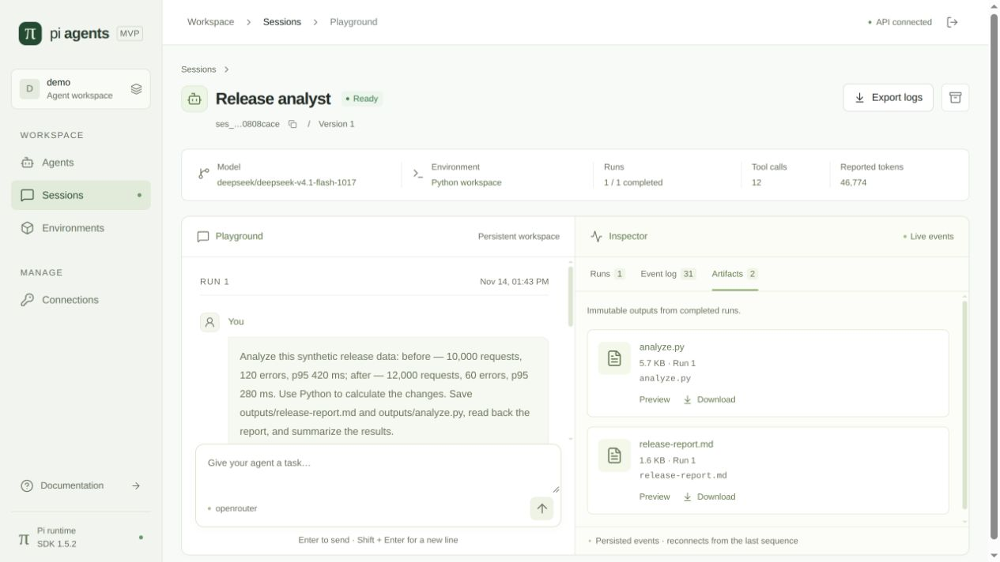
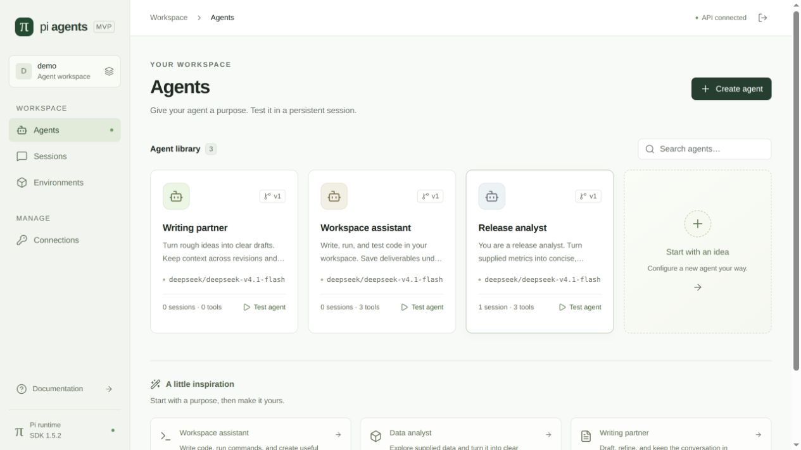
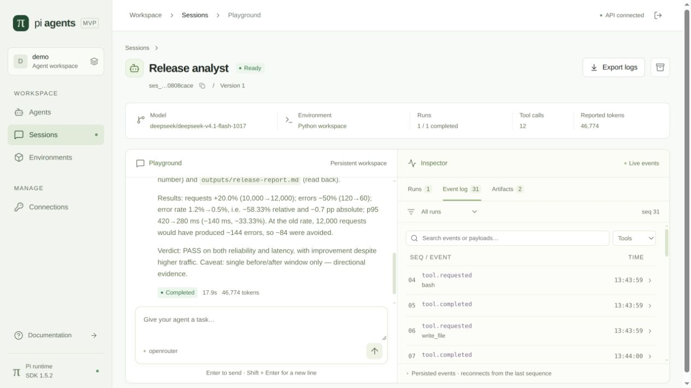
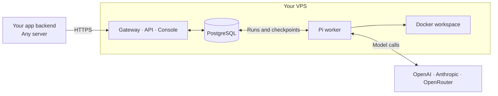
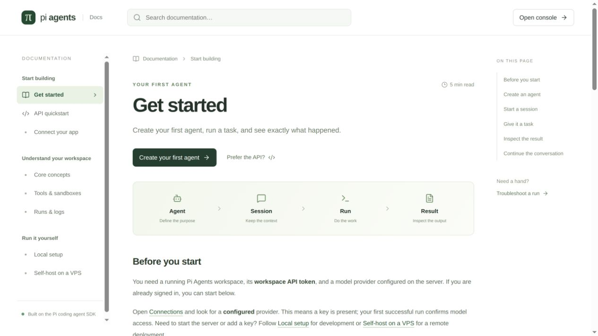

# Pi Managed Agents API

**Give your apps agents that run code, keep context, and deliver files. Powered by Pi. Hosted by you.**

[](https://github.com/taherchhabra/pi-managed-agents-api/actions/workflows/check.yml)

[Get started](#get-started) · [Connect your app](#connect-your-app) · [Built-in documentation](#documentation-in-your-workspace) · [Architecture](docs/architecture.md)

Useful agents need a place to work, a way to carry context into the next task, and a record of what happened. Pi Managed Agents brings those pieces together in a self-hosted API and browser console built around the **Pi coding agent SDK**.

Define an agent, give it a workspace, and send it a task. Pi handles the model and tool loop; the service saves session state, runs code in Docker, records progress, and publishes the resulting files. Your application can call it from any server over HTTPS.



*A real DeepSeek run through OpenRouter: synthetic release metrics become a Python analysis and a downloadable report. Screenshots use a separate demo workspace.*

## Build an agent. See it work.

Start with instructions, a model, and the tools your agent needs. Use **OpenAI, Anthropic, or OpenRouter**, including DeepSeek V4.1 Flash 1017 through OpenRouter. The console shows the models available in the installed runtime.

Save a version, select **Test agent**, and send a task. You can build a coding assistant that writes and tests Python, an analyst that turns supplied data into a report, or a writing partner that keeps context through revisions.

Every saved agent version is immutable. Existing sessions keep their original configuration while you try new instructions or models in another session.



## Keep the conversation and the workspace

A session connects an agent version to an environment. Send related tasks to the same session to continue the conversation and work with the files it already created.

| You define | The service keeps |
| --- | --- |
| **Agent** | Versioned instructions, provider, model, and allowed tools |
| **Environment** | A managed Docker workspace or a conversation-only session |
| **Session** | Conversation context, checkpoints, and persistent workspace files |
| **Run** | One submitted task, its status, output, and reported usage |
| **Events and artifacts** | Saved execution history and downloadable output snapshots |

Managed workspaces provide **Bash, Python, file reads, and file writes**. Each attempt runs in a fresh container with the session's persistent volume. Files saved under `outputs/` are published as artifacts after a successful run, ready for your app to download.

Disconnecting your app or closing the console does not cancel a run. Reopen the session to inspect its result, or reconnect to the event stream from the last sequence you received. Interrupted worker execution follows an explicit recovery flow; uncertain tool effects are never automatically replayed.

## Follow every run

The console puts the conversation and execution history side by side. Inspect a run's tool calls, expand their arguments and results, search the event log, and preview or download its artifacts. Export the saved session history when you need to investigate a result.

The API exposes that same history through a resumable **server-sent event stream**. These are saved lifecycle, tool, and result events; assistant responses appear when complete.



## Connect your app

Host Pi Agents on a VPS and call it from your application backend, wherever that backend runs. Your app needs an **API URL** and a **workspace token**. Model provider credentials stay on the agents server.

Create an agent and start a session in the console, then copy its session ID. Set these variables in your backend environment:

```dotenv
API_URL=https://agents.example.com
API_TOKEN=your-workspace-token
SESSION_ID=your-session-id
```

Submit work with standard HTTP. This Node.js example starts a run in that session:

```js
import { randomUUID } from 'node:crypto';

// Keep this key and body if you need to retry this submission.
const requestId = randomUUID();
const input = 'Read our previous report and write a concise release summary.';
const sessionUrl = `${process.env.API_URL}/v1/sessions/${process.env.SESSION_ID}`;

const response = await fetch(`${sessionUrl}/runs`, {
  method: 'POST',
  headers: {
    Authorization: `Bearer ${process.env.API_TOKEN}`,
    'Content-Type': 'application/json',
    'Idempotency-Key': requestId,
  },
  body: JSON.stringify({ input, when_busy: 'queue' }),
});

if (!response.ok) throw new Error(await response.text());
const run = await response.json();
console.log(run.id, run.status);
```

A `202` response means the input was accepted and saved. Read `GET /v1/sessions/:session/runs/:run` for completion, or follow `GET /v1/sessions/:session/events?stream=true`. List outputs at `GET /v1/sessions/:session/artifacts`; downloads use the same bearer authentication.

The [complete runnable example](examples/run.mjs) creates the agent, environment, and session too, follows events, and prints the final result. The API quickstart inside the console walks through the whole flow.

Keep workspace tokens in your backend and authenticate your own app's users there. Keys mapped to one workspace share its data; separate workspaces isolate different apps. This project has its own HTTP contract; OpenAI and Claude SDK compatibility adapters are future work.

## Pi at the core, infrastructure you control

The **Pi coding agent SDK** handles model interaction, tool selection, and context management. This service supplies API authentication, asynchronous work, persisted checkpoints, Docker execution, event history, and artifact storage around it.



The VPS package separates the API from the worker. Only the worker receives model provider keys and Docker access. Tool containers run as a non-root user with a read-only root filesystem, **1 CPU**, **512 MiB RAM**, and networking disabled. Database state, session workspaces, and published artifacts persist on the host.

You operate the service and choose the model provider. The current runtime is pinned to Pi SDK **1.5.2**.

## Get started

### Self-host on a VPS

Use a dedicated Linux VPS with **Docker Engine and Compose**, **Git**, and **Node.js 22.19+**. Point a domain at the server and allow inbound TCP ports **80 and 443**.

```sh
git clone https://github.com/taherchhabra/pi-managed-agents-api.git
cd pi-managed-agents-api
node scripts/vps.mjs init agents.example.com you@example.com
# Add a model provider key to the generated .env.vps file.
node scripts/vps.mjs up
```

The helper generates private credentials and starts Caddy HTTPS, PostgreSQL, the API/console, and the Pi worker. Open your domain and sign in with the workspace token in `.env.vps` → `API_KEYS`.

From there, follow **Documentation → Self-host on a VPS** for deployment checks, application tokens, updates, backups, and recovery. **Connect your app** explains how to use the hosted API from another server.

### Run locally

With the same prerequisites and npm, run these commands from the checkout:

```sh
npm ci
docker compose up -d --wait
docker build -f Dockerfile.sandbox -t pi-managed-sandbox:dev .
[ -f .env ] || cp .env.example .env
```

Edit `.env`: replace the token in `API_KEYS` and set `OPENROUTER_API_KEY`, `OPENAI_API_KEY`, or `ANTHROPIC_API_KEY`. Then run `npm run dev` and open **http://127.0.0.1:8080**.

Sign in with the workspace token, create an agent, and choose **Test agent**. For a first task, ask it to write and run a Python program and save the results under `outputs/`.

## Documentation in your workspace

Getting started, API integration, sessions, tools, logs, and VPS operations are documented **inside the UI**, alongside the agents you are building. Search the guides, copy runnable examples, and follow links straight into the console.



On a local install, [open Documentation](http://127.0.0.1:8080/#/docs/get-started). Every hosted instance serves the same guides at `/#/docs/get-started`, including before sign-in.

## Current scope

This is an MVP for a trusted operator on **one Linux Docker host**. It includes versioned agents, persistent sessions, queued runs, cancellation, explicit recovery, replayable events, artifacts, a console, and HTTPS deployment. The default stack has one API process and one worker.

Public untrusted-code hosting needs a stronger execution boundary, scoped user permissions, disk and spending quotas, and additional operational hardening. High availability, MCP, custom application tools, approvals, and subagents are future work. The [MVP contract](docs/mvp.md) documents implemented behavior and limits.

<details>
<summary><strong>Development and verification</strong></summary>

With development PostgreSQL running and the sandbox image built:

```sh
npm run check
npm run build
```

The tests use the real Pi SDK, PostgreSQL, and Docker with a local model-response fixture. `npm run test:deployment` also builds the full VPS stack and connects from a separate application container over verified HTTPS. Both run in [GitHub Actions](https://github.com/taherchhabra/pi-managed-agents-api/actions/workflows/check.yml) without model credentials.

For real inference, set `OPENROUTER_API_KEY` in your ignored `.env` file:

```sh
npm run test:live
npm run test:deployment:live
```

These opt-in tests use provider credits. The live suites verify model responses, Docker tools, artifacts, saved state, and follow-up work. The deployment suite also restarts the API, worker, and database before continuing the session. OpenRouter inference has been verified with GPT-4.1 mini and DeepSeek V4.1 Flash 1017; direct OpenAI and Anthropic inference remains unverified. [Live test details](docs/live-testing.md).

For UI development, run `npm run dev:api` and `npm run dev:ui` separately. The Vite UI is available at `http://127.0.0.1:5173`. [Console development guide](docs/console.md).

</details>

The design draws on the session-oriented approach described in the [OpenAI Agents API launch](https://openai.com/index/introducing-the-agents-api/) and [Claude Managed Agents launch](https://claude.com/resources/articles/claude-managed-agents). See the [provider architecture research](docs/provider-architecture.md) and [Pi architecture](docs/architecture.md) for the design decisions behind this implementation.
