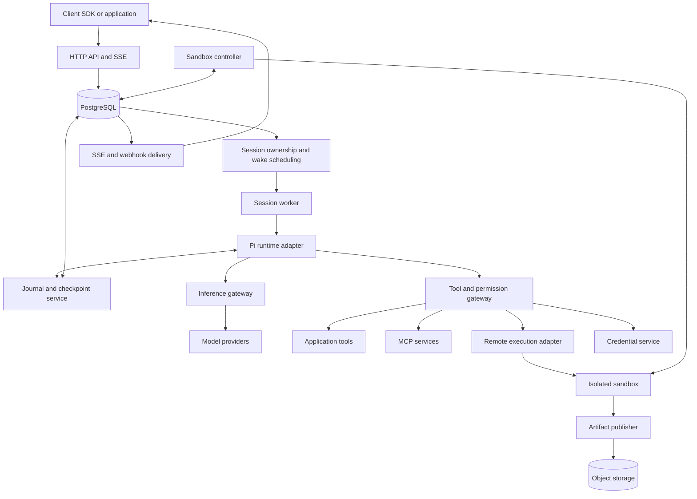

# Pi Managed Agents API architecture proposal

Status: architecture target, 13 November 2026. An initial vertical slice is implemented and tested; see [the MVP contract](mvp.md) for its supported surface and recovery limits. The rest of this document includes planned capabilities.

Build a session service around Pi, with the agent harness running separately from generated code. Use a native API inspired by the documented OpenAI and Claude contracts in [the provider comparison](provider-architecture.md). Keep provider compatibility behind later adapters so differences in events, approvals, and completion remain explicit.

The initial scope is a hosted API with multiple tenants, one region, asynchronous work, and Linux sandboxes. The same components should be deployable by a single organization. Traffic targets, hosting provider, and retention periods remain product decisions; this proposal makes no throughput or availability claim.

## Harness choice

**Use the Pi coding agent SDK as the harness.** Embed `@earendil-works/pi-coding-agent` in a session worker through `createAgentSession()`. Pi supplies the model/tool loop, conversation handling, compaction, steering, and runtime events. The service supplies durable command acceptance, checkpoints, worker ownership, tool reconciliation, and public API state. [Pi SDK](https://github.com/earendil-works/pi/blob/4be4cb4f5e9c64bf730ee2036ebac2ce9f97a6cf/packages/coding-agent/docs/sdk.md).

Pin the SDK and platform extension bundle for each session. The documentation baseline is upstream commit `4be4cb4f5e9c64bf730ee2036ebac2ce9f97a6cf`; the MVP pins and tests SDK version `1.5.2`. Use explicit model, resource-loader, tool, settings, and session-manager configuration so a worker does not discover ambient user credentials or project extensions.

`SessionManager` is authoritative for finalized model context. Restore its entry tree and active branch, including compaction and context edits, rather than assigning an array to the live agent's message state. SDK persistence does not provide the service's distributed recovery protocol. [Pi session format](https://github.com/earendil-works/pi/blob/4be4cb4f5e9c64bf730ee2036ebac2ce9f97a6cf/packages/coding-agent/docs/session-format.md).

## Component layout

Start as a TypeScript codebase with API and worker deployment roles, a shared PostgreSQL database, and object storage. The component boundaries are modules and trust boundaries; each does not need its own microservice.

| Component | Responsibility |
| --- | --- |
| API | Authentication, tenant access, validation, idempotency, command admission, reads, streaming |
| Session scheduler | Wake due work, assign one writer, renew leases, recover abandoned sessions |
| Runtime adapter | Translate public inputs, outcomes, and tool requests into pinned Pi behavior |
| Journal and checkpoints | Save recoverable SDK session state; commit service state, public events, and outbox records transactionally |
| Tool gateway | Enforce permissions and budgets; track calls, external results, and uncertain outcomes |
| Sandbox controller | Provision, connect, fence, suspend, restore, and destroy execution instances |
| Delivery workers | Deliver signed webhooks and notifications from durable outbox records |

The runtime process loads only platform-controlled executable extensions. User-provided executable extensions would require a separate harness isolation boundary. Project instructions and skills are input to the agent, not authority to load arbitrary code into the service.

## Public resource model

| Resource | Meaning |
| --- | --- |
| Agent and AgentVersion | Reusable behavior plus immutable revisions: provider/model, instructions, tools, skills, runtime and extension pins |
| EnvironmentTemplate | Execution recipe: image, resource limits, network policy, setup, storage policy, or a customer worker pool |
| Session | Durable ownership and authorization boundary; captures agent and environment revisions |
| Thread | One conversation within a session; the first thread is the root |
| Run | One requested unit of agent work, with its inputs, status, usage, and result |
| ToolCall and Action | Tool invocation and any pending approval or external result |
| Sandbox | A concrete execution instance with its own generation and connection status |
| Artifact | Immutable published output with content digest, ownership, and retention |
| Event | A versioned public fact with a monotonically increasing session sequence |
| CredentialBinding | A permitted reference to credentials for a user, session, service, and scope |

A session's lifecycle is `active → archived → deleted`. Its activity is derived from runs and pending actions. Runs use `queued`, `running`, `waiting`, `recovering`, `cancelling`, `completed`, `failed`, or `cancelled`; `waiting` includes a structured reason. Sandboxes have independent provisioning, connection, and cleanup states.

Pin configuration for an active run. A later agent revision does not silently change existing sessions. An explicit session update, allowed while no run is active, records a new configuration revision for subsequent runs.

### Pi mapping

| API concept | Pi SDK integration or service responsibility |
| --- | --- |
| Session | Service ownership scope containing configuration, runs, and threads |
| Thread | One `AgentSession` and its `SessionManager`, restored by the owning worker |
| Run | Service run record covering a `prompt()` call and accepted steering inputs |
| Steer | A journaled input delivered through `steer()` while the target run is active |
| Model step | An SDK message/tool cycle within a public run |
| Pending action | PostgreSQL record correlated with a custom tool invocation |
| Environment | Service executor reached through explicitly registered custom tools |
| Public event | Service-owned event persisted before delivery |

`message_end` provides a completed message. `agent_end` can be followed by retries or queued work; `agent_settled` indicates that Pi will not continue automatically. Complete a public run only after inspecting the final outcome, flushing its checkpoint, resolving required work, and publishing its required artifacts. [Pi SDK events](https://github.com/earendil-works/pi/blob/4be4cb4f5e9c64bf730ee2036ebac2ce9f97a6cf/packages/coding-agent/docs/sdk.md#subscribing-to-events).

## Initial HTTP surface

These are proposed endpoints, not upstream Pi APIs.

| Method and path | Behavior |
| --- | --- |
| `POST /v1/agents` | Create an agent with its first immutable version |
| `POST /v1/agents/{id}/versions` | Create a new behavior revision |
| `POST /v1/environment-templates` | Save an execution recipe |
| `POST /v1/sessions` | Create a durable session using pinned revisions |
| `GET /v1/sessions/{id}` | Return configuration, activity, pending actions, and snapshot cursor |
| `POST /v1/sessions/{id}/runs` | Admit input and return `202` with a run ID |
| `GET /v1/sessions/{id}/runs/{run_id}` | Read authoritative run status and outcome |
| `POST /v1/sessions/{id}/runs/{run_id}/inputs` | Steer that run; never create a replacement run implicitly |
| `POST /v1/sessions/{id}/runs/{run_id}/resume` | Request recovery after checkpoint validation and tool reconciliation |
| `POST /v1/sessions/{id}/runs/{run_id}/cancel` | Record cancellation intent and return its current status |
| `GET /v1/sessions/{id}/events` | Read durable events after a cursor, or stream them using SSE |
| `POST /v1/sessions/{id}/actions/{action_id}/resolve` | Supply an approval decision or external tool result |
| `GET /v1/sessions/{id}/artifacts` | List published outputs and authorized download references |
| `POST /v1/sessions/{id}/archive` | Stop new work and begin coordinated cleanup |

Include standard list/read operations for agents and templates. Add thread operations with multi-agent support. Deletion is a separate asynchronous operation that tracks data and compute cleanup.

An admitted command is durable before `202`; acceptance does not mean execution succeeded. Mutations use an idempotency key scoped to tenant and endpoint. Store the normalized request hash and original response: identical retries return it, while a changed body with the same key returns a conflict.

Allow one active root run per session initially. New runs explicitly choose enqueue or reject when busy. The service queue activates the next run after its predecessor is terminal, rather than allowing Pi to merge several queued user inputs into one public run. Steering references the active run ID and uses reject-if-idle semantics. If the target finishes before a queued steer is applied, record that rejection instead of starting fresh work.

## Persistence and worker ownership

Use PostgreSQL for the agent catalog, accepted commands, sessions, leases, checkpoint metadata, public events, tool ledger, and outbox. Store complete SDK checkpoint payloads in PostgreSQL initially; large file contents and artifacts belong in object storage. Keep the full transcript distinct from the compacted context sent to a model.

The service owns a journal of accepted inputs, runtime attempts, tool intent/results, and checkpoint boundaries. A checkpoint includes the session entry tree, active leaf, model/settings revision, runtime version, and the last fully incorporated command. A local JSONL file is a working copy, not the authoritative recovery store. Build and validate import/export against the pinned `SessionManager` interfaces; do not assume a pluggable PostgreSQL backend exists in the SDK.

Acquire a lease with an increasing ownership epoch before activating a session worker. Every service checkpoint and state transaction verifies that epoch. Tool dispatch carries it too, checked by the gateway and executor. Lease renewal failure stops dispatch and aborts the old worker; stale workers cannot publish results after replacement.

Idempotency belongs to the API command ledger. An SDK `prompt()` call is not a durable, idempotent submission API. Record the command and attempt before invoking it, then checkpoint its incorporation into session history. After a crash, compare the checkpoint with accepted commands and the tool ledger before deciding what can resume. Never resend an input solely because the previous worker did not return.

SDK event listeners report activity; they are not an awaited database commit barrier. The adapter must establish persistence boundaries explicitly. Custom tool wrappers save the call and recoverable context before dispatching any external effect, and save the result before returning it to Pi. At run completion, flush a complete checkpoint before committing the terminal status. If the pinned SDK cannot expose a sufficient checkpoint at a required boundary, keep that attempt interrupted until the adapter can reconstruct it safely; do not claim transparent continuation.

Commit each service state transition, its checkpoint reference when applicable, and public events/outbox records in one PostgreSQL transaction. This transaction does not include Pi's in-memory mutations or external tool effects. Recovery reconciles those boundaries using the journal. Notifications only wake consumers; consumers recover from the database.

For the MVP, a worker lost during active execution leaves the run `waiting` with reason `recovery_required`. An explicit resume validates the checkpoint, reconciles tool outcomes, restores a new SDK session, and records a new attempt. Enable automatic recovery only for boundaries covered by failure tests. Pin checkpoint schemas and extension versions; incompatible checkpoints remain blocked or use the original runtime.

## Events and streaming

Define public events such as `input.accepted`, `run.started`, `message.completed`, `tool.requested`, `action.required`, `artifact.published`, and terminal run outcomes. Each has a schema version, event ID, session sequence, timestamps, and relevant run/thread/call IDs.

Support `after` and SSE `Last-Event-ID` over retained semantic events. Reconnection reads the backlog and then tails new commits without a subscription gap. Clients deduplicate by event ID. If a cursor has expired, return `410` with a way to fetch a snapshot at a consistent cursor. Webhooks deliver at least once, are signed, and carry those same event IDs.

Token deltas and running command output are provisional previews. Give them stream and generation identities, not durable replay cursors; a committed message or result replaces the preview. Subscribe before prompting and normalize SDK events in the adapter. The service stores authoritative events before publishing them and rebuilds client views from its own journal after reconnecting.

## Tool calls and human input

Each tool call records its ID, arguments, arguments hash, execution generation, policy decision, attempt, outcome, and replay policy before dispatch. Supported replay classes are read-only, externally idempotent, and unsafe to repeat. A declared safe replay still needs stable downstream idempotency for external writes.

A pending approval stores the exact call, final arguments hash, actor scope, expiry, and policy revision. Resolve it only for an authorized actor and a still-pending call. Any change to the action invalidates the approval. Enforcement occurs immediately before the effect, after argument transformations.

External functions use the same pending-action machinery: the service records a request, and the application returns a correlated result. A custom tool implementation waits for that PostgreSQL record to resolve. Keep the SDK worker alive during this wait in the MVP; suspending and reconstructing a tool invocation is separate recovery work. Approval decisions and tool results survive restart even though the JavaScript promise does not. Resolution retries are idempotent, and late or conflicting results have explicit terminal responses. A replacement worker restores the pending action and reconciles the invocation before continuing; it never creates a second request merely because the process restarted.

If an external action may have completed but its result was lost, mark the call outcome unknown. Query the downstream operation by its stable ID or require reconciliation. Do not repeat a potentially destructive effect merely because its caller restarted. Arbitrary shell commands default to unsafe to replay.

## Sandboxes and credentials

Provide `none`, `managed`, and `self_hosted` execution modes. `none` has no filesystem or shell tools. Managed execution provisions one sandbox per session initially; self-hosted execution routes to an authorized customer worker pool.

Register platform-controlled custom tools for shell and file operations. Their awaited implementations call the service's executor protocol, carrying session, sandbox generation, ownership epoch, operation ID, deadline, and cancellation information. Disable built-in tools that would touch the worker's host filesystem. Remote execution, transport reconnection, and sandbox lifecycle are service components. Pi exposes explicit tool selection and extension-based custom tool registration. [Pi tools example](https://github.com/earendil-works/pi/blob/4be4cb4f5e9c64bf730ee2036ebac2ce9f97a6cf/packages/coding-agent/examples/sdk/05-tools.ts).

Run generated code in disposable containers or VMs with an explicit isolation policy, resource limits, and enforced network access. Scope executor credentials to one session and sandbox generation. Do not expose service database access, tenant administration credentials, or model provider keys inside the sandbox.

Use an inference gateway for model access and a tool/MCP gateway for service credentials. Authorization resolves from tenant, user, session, tool, and destination. A vault reference alone grants no access. Only approved executable extensions run beside these trusted components.

A restored conversation does not restore a workspace. Preserve it through a durable volume or versioned snapshots, recording the sandbox generation and workspace checkpoint. If the required workspace is unavailable, pause with a specific reason; do not silently continue against an empty directory. A stale worker's already-running command also needs cancellation or reconciliation before replacement execution proceeds.

Publish artifacts through a controlled export step with digest verification and tenant ownership. Make `run.completed` wait for required artifact publication; otherwise return an explicit publication failure. Artifacts survive sandbox cleanup under their own retention policy. Input uploads, mutable workspace files, and immutable outputs remain distinct resources.

## Recovery and cancellation

| Failure point | Required behavior |
| --- | --- |
| API response lost after acceptance | Same idempotency key returns the accepted command/run |
| Worker dies during model generation | Preserve accepted work; restore the last verified SDK checkpoint and reconcile the interrupted attempt before resuming |
| Worker dies after an external tool effect | Reconcile the operation; reuse a recorded result or downstream idempotency key |
| Owner lease expires | Fence old commits and new dispatch; reconcile already-running operations |
| Client stream disconnects | Keep running; resume public history from its cursor |
| Approval waits through restart | Restore the pending action; reconstruct the SDK invocation only after validating its checkpoint and tool ledger |
| Sandbox is lost | Restore a known workspace checkpoint or pause for recovery |
| Public notification is lost | Deliver again from the durable outbox |
| Runtime upgrade cannot read a checkpoint | Use the original runtime or surface an explicit blocked state |

Cancellation is an operation: persist intent, stop new work, call the SDK's `abort()`, cancel executor operations, resolve pending waits as cancelled, and record the terminal outcome after cleanup. A cancellation cannot undo an external write already completed. Start with no detached background work; when introduced, give it separate ownership and cancellation controls.

## Metering and isolation

Authorize every resource lookup by tenant; propagate tenant identity through storage, queues, downloads, connectors, and webhook delivery. Public cursors and tool IDs do not grant access.

Apply concurrency limits by tenant and session. Meter model attempts, compaction, tools, and sandbox time. Track usage that is unknown after an interrupted provider request instead of treating it as zero. Budget checks stop new work; requests already in flight can exceed a spend threshold. A strict reservation-based ceiling would need provider-specific upper bounds and reconciliation.

Record correlated traces using session, run, thread, model-request, and tool-call IDs. Keep sensitive transcript contents out of default operational logs; provide authorized transcript access separately.

## Implementation stages

1. **Qualify the SDK integration.** Pin Pi and implement checkpoint import/export plus remote custom tool spikes. Verify compaction/branch restoration, interrupted assistant/tool-result pairing, awaited persistence boundaries, steering, cancellation, and final-outcome detection. Keep automatic recovery disabled until these cases pass.
2. **Build one complete vertical path.** Agent version → session → durable run acceptance → one Pi owner → one managed sandbox provider → streamed results → artifact download. Include idempotency, cancellation, tenant access, and failure reporting.
3. **Harden operations.** Add fenced ownership transfer, verified recovery, workspace restoration, budget enforcement, external tools, approvals, signed webhooks, secret mediation, retention, and complete cleanup reconciliation before public multi-tenant use.
4. **Extend orchestration.** Add customer executors, child threads, shared budget/cancellation rules, schedules, and compatibility adapters. Define workspace sharing explicitly when adding child agents.

The minimum acceptance exercises kill workers before and after input commits, tool effects, and result commits; race cancellation with results; expire an owner during execution; reconnect streams during writes; restart while awaiting approval; lose a sandbox; and attempt cross-tenant resource access. These exercises validate service guarantees that an SDK smoke test cannot establish.
