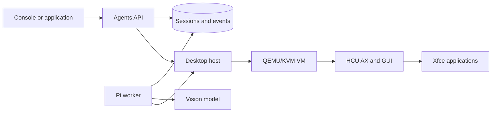

# Linux desktops with HCU

Desktop sessions use **Ubuntu 24.04 LTS, Xfce, QEMU/KVM and Microsoft Hybrid Computer Use (HCU)**. Pi remains the agent harness. HCU supplies its native `AX` and `GUI` tools: accessibility observations and guarded actions, screenshots, mouse input, typing, scrolling and zoom.

## Try it in the console

1. Configure a desktop host as below. Restart the API and worker.
2. Choose **Desktop assistant** in Agents. Select a vision model, such as `deepseek/deepseek-v4.1-flash-1017` through OpenRouter. Keep **Accessibility · HCU** and **Screen & input · HCU** enabled.
3. Select **Test agent → Linux desktop**. Choose **Network access**: Off, Internet, or Allowlist, then **Start session**.
4. Ask it to inspect the screen, open Mousepad, and save a note under `/workspace/outputs/`. With Internet enabled, ask it to open Web (Epiphany) and visit a public website.
5. The **Desktop** tab shows a read-only preview, refreshed every three seconds. **Agent observations** shows the actual images delivered to the model. Runs and Event log include AX/GUI arguments, status, errors and screenshots. Artifacts contains saved outputs after a successful run.

The first message boots the VM. Finishing or cancelling a run stops HCU input and pauses the VM. A follow-up resumes the same applications and files. Archiving a session destroys its VM and disk; event history, screenshots and published artifacts remain.

## Local setup

Use an **x86-64 Linux host with working `/dev/kvm` access**, QEMU system x86, qemu-img, Python 3, `setpriv` (util-linux), Node 22.19+ and Docker (for building HCU). On Ubuntu, install `qemu-system-x86 qemu-utils python3 util-linux` and give the desktop service user membership in `kvm`. Log in again after changing groups. Nested virtualization must be enabled if the host is itself a VM. There is no software-emulation fallback.

```sh
npm ci
npm run build:hcu
npm run desktop:image
```

The image builder downloads the official Ubuntu cloud image, verifies its published SHA-256 checksum, installs Xfce, applications, HCU and the guest helpers, then shuts it down and creates `.data/desktop/ubuntu-hcu.qcow2`. Allow several minutes and roughly 8 GB of temporary disk space. Image building needs internet. Session networking defaults to Off; connected desktops use the restricted proxy described below. Run the builder from the repository root. Do not run two builders in the same build directory.

Generate a **separate desktop-host secret**, for example with `openssl rand -hex 32`. Store the same value in two ignored files, readable only by their service users:

```dotenv
# .env — API and worker
DESKTOP_HOST_URL=http://127.0.0.1:8090
DESKTOP_HOST_TOKEN=YOUR_GENERATED_SECRET
```

```dotenv
# .env.desktop — desktop host only
DESKTOP_HOST_TOKEN=YOUR_GENERATED_SECRET
DESKTOP_BIND=127.0.0.1
DESKTOP_PORT=8090
DESKTOP_BASE_IMAGE=.data/desktop/ubuntu-hcu.qcow2
DESKTOP_DATA_DIR=.data/desktop/sessions
DESKTOP_MEMORY_MB=1536
DESKTOP_MAX_VMS=2
```

Run `npm run desktop:host` in one terminal and restart `npm run dev` in another. Paused VMs retain their RAM, so the capacity limit counts both running and paused VMs. Budget at least 1.5 GB RAM per VM plus host/API/database overhead; archive unused sessions to free capacity. Guest disks have a 16 GB virtual size; monitor host storage separately.

## VPS or separate desktop server

The API and worker use an authenticated HTTP client to the desktop host. They need no KVM device or QEMU installation. Keep them on a VPS and run the desktop host on a dedicated Linux server if your VPS cannot expose KVM.

Build the app with `npm run build`. The host entry point is `node dist/src/desktop/main.js`. Run it as a non-root service user with KVM access; root is rejected. Keep `deploy/desktop/` alongside `dist/` because the host loads the trusted guest helpers and proxy bridge from there. `deploy/desktop/pi-desktop.service` is a systemd example: create the `pi-desktop` service user with KVM access, place the repository under `/opt/pi-managed-agents-api`, the base image under `/var/lib/pi-desktop/ubuntu-hcu.qcow2`, and the secret configuration at `/etc/pi-desktop.env` with mode 0600. Set:

```dotenv
DESKTOP_HOST_TOKEN=YOUR_GENERATED_SECRET
DESKTOP_BASE_IMAGE=/var/lib/pi-desktop/ubuntu-hcu.qcow2
DESKTOP_DATA_DIR=/var/lib/pi-desktop/sessions
DESKTOP_RUNTIME_DIR=/run/pi-desktop
DESKTOP_BIND=127.0.0.1
DESKTOP_PORT=8090
DESKTOP_MAX_VMS=2
DESKTOP_MEMORY_MB=1536
```

Install and start the systemd unit. Expose the host through an authenticated **HTTPS reverse proxy or private encrypted tunnel**, accessible only to the API and worker. The token is an infrastructure credential with control over every VM on that host. Keep QMP and QGA sockets private; the browser communicates only with the public agents API.

Set `DESKTOP_HOST_URL=https://desktop.internal.example` and the matching `DESKTOP_HOST_TOKEN` in `.env.vps`, then recreate both API and worker. These variables are forwarded by `compose.vps.yaml`. **`127.0.0.1` inside a Compose container is not the host machine**: use the private desktop-service address reachable from both containers. The API's frontend network and worker's egress network can reach a remote desktop host.

An ordinary API or worker restart preserves the desktop VM. Restarting the desktop host fences old input and pauses existing VMs; interrupted runs need reconciliation. A physical host reboot loses open applications and in-memory state; the session disk survives and the next run boots it again. There is no RAM snapshot, migration, idle eviction, Windows provider or macOS provider in this MVP. Keep each session on the same desktop host/data directory. Never load-balance requests across independent hosts.

## API

Create an agent with `tools: ["AX", "GUI"]` (add Bash/file tools if wanted), then an environment template with `type: "desktop"`. Use the existing session/run lifecycle. A model without image input is rejected before creating a desktop-enabled agent.

| Endpoint | Purpose |
| --- | --- |
| `GET /v1/capabilities` | `desktop.configured`, supported network modes/protocols, and each model's `input` modalities |
| `GET /v1/sessions/:session/desktop` | VM state, pinned network policy, and current-run proxy counters |
| `GET /v1/sessions/:session/desktop/frame` | Current/cached JPEG preview, no-cache |
| `GET /v1/sessions/:session/screenshots/:id` | Immutable observation from a tool-completed event |

All endpoints use normal workspace authentication and tenant checks. A preview is independent of HCU's last observed screen, so viewing it does not invalidate the model's coordinate state. There is no direct mouse/keyboard API for browser users in this version.

## Network access

Choose the policy when creating a **Linux desktop** environment or starting a test session. The console shows it on environment cards, in the test dialog, and below the desktop preview.

| Mode | Behavior |
| --- | --- |
| **Off** (default) | No network adapter; local apps and files still work. |
| **Internet** | Public HTTP/HTTPS destinations through a proxy. |
| **Allowlist** | The same proxy, limited to approved destination domains. |

```json
{
  "name": "Research desktop",
  "type": "desktop",
  "network": {
    "mode": "allowlist",
    "allowed_domains": ["example.com", "*.example.com"]
  }
}
```

Send this body to `POST /v1/environment-templates`, then pass the returned environment ID when creating a session. For Internet use `"network": {"mode": "internet"}`; omitting `network` means Off. Docker and conversation-only templates accept only Off. `GET /v1/environment-templates` includes `network`; session responses include `environment_network`.

An exact hostname allows only that hostname. `*.example.com` allows its subdomains, including nested subdomains, but **does not include example.com itself**. Supply hostnames, not URLs, ports, paths, or IP addresses. Up to 100 entries are supported. Redirects and page assets may require additional approved domains. Private or reserved IP destinations remain blocked even when their hostname is allowlisted.

Templates are immutable and each session pins its policy. **Existing offline sessions stay offline.** To change access, create a new environment and session. The host also checks the pinned policy on every resume and rejects a mismatch.

Connected guests use a restricted QEMU user network (`restrict=on`, IPv6 off). Only the fixed proxy endpoint can forward traffic. A small host-side bridge connects each forwarded connection to that session's private Unix socket. The proxy resolves and validates destinations outside the VM, rejects private/reserved/metadata addresses and the host's interface addresses, and dials the validated numeric IP without a second DNS lookup. Changing browser settings or unsetting proxy variables cannot create a direct route.

On the first connected boot, the host configures the proxy and restarts the unused Xfce session once so apps inherit it. Later runs preserve open applications. Web (Epiphany) receives desktop proxy settings; Bash/file tools receive `http_proxy` and `https_proxy`. Only HTTP port 80 and CONNECT port 443 are supported, using IPv4 upstream. Apps that ignore proxies, direct TCP, SSH on port 22, UDP, QUIC and direct DNS do not work. CONNECT tunnels are opaque and are not inspected for TLS or application protocol; HTTPS is passed through without interception: allowlisting controls the requested destination, not page content or services offered by an approved endpoint. It is not a content filter or a guarantee against a permitted site acting as a relay.

For additional operator restrictions, set `DESKTOP_EGRESS_BLOCKED_CIDRS` in **the desktop host's** configuration, for example a comma-separated list of your infrastructure's public IPv4 addresses/CIDRs. Include the host's public NAT address and any publicly reachable administration services: addresses not assigned to a local interface cannot be identified automatically. This setting only adds denials. Restart the desktop host after changing it. No root-owned bridges, host port forwarding, or guest credentials are required.

The online QEMU process runs under `setpriv --no-new-privs`. QEMU's spawn and privileged-syscall deny groups must be relaxed for libslirp's fixed bridge (`setsid` and exec); its other seccomp filters stay enabled. Offline VMs retain all four deny groups. The non-root service account and inherited `no_new_privs` prevent the bridge from gaining privileges. The supplied systemd unit also bounds total tasks; each session allows at most 32 proxy connections, with idle and lifetime timeouts.

Finishing or cancelling a run revokes proxy connections before pausing the VM. A desktop-host restart fails closed and pauses guests; a new run restores its pinned proxy. The Desktop tab reports allowed/blocked HTTP requests and CONNECT tunnels and the last rejected hostname for the current run. Counters reset on the next run or host restart; they are not a durable traffic log. Proxy denials return HTTP 403, while DNS or upstream failures return 502 (or a failed CONNECT). URLs, headers and response bodies are not logged.

The host injects the updated guest helpers on each run, so existing HCU base images do not need rebuilding for proxy support. Deploy the updated API/worker, run migrations, restart the desktop host, and create a new connected session.

## Design and limits



- One qcow2 overlay per session; one immutable operator-selected base image. No host directories, control-plane secrets or model keys are mounted inside guests.
- The host uses QEMU's documented QMP and guest-agent protocols over private Unix sockets. A root-owned guest runner drops to the desktop user for all tools. The user has no sudo or polkit elevation.
- The host installs its trusted guest helpers at the start of each generation. HCU itself is pinned in the base image. Build a new image to update HCU or guest packages; never replace a base image while existing session overlays reference it.
- Generation fencing exists in PostgreSQL, the desktop host and guest runner. Cancellation stops the HCU daemon and dispatchers before pausing the VM. Previously emitted UI actions are not undone. Unknown effects enter the existing recovery flow; desktop input is never automatically replayed.
- HCU 1.0.0 (MIT) is pinned to upstream commit `697d3fbda04cb322915866bab1aad79c726a61e3`. HCU runs once per active generation. Every new run must observe again. Its reference-counter file survives daemon restarts. HCU guards target identity and window layout; transport failures are not converted into permission to retry input.
- HCU screenshots preserve their pixel dimensions. They are JPEG-encoded for transport (maximum 1 MiB). The worker stores image objects separately; events contain authorized URLs rather than base64. Checkpoints retain four recent images; earlier observations remain in the event history.
- Existing run limits remain: 32 tools, five minutes per run, bounded file reads/writes and artifact export. HCU calls have a 40-second guest execution limit. The MVP uses one desktop host and has no automatic guest package updates or arbitrary TCP/UDP egress.
- A non-root QEMU process and seccomp provide a VM boundary; this is not a hardened public multi-tenant desktop offering. Treat the desktop host as trusted execution infrastructure.

## Verification

`npm test` checks model admission, tenant isolation, archive behavior, real Pi image payloads and durable screenshot references using a deterministic model transport.

`npm run test:desktop` boots a disposable VM from your built image. It checks HCU screenshots and accessibility, cancellation of an in-flight process, rejection of stale generations, persistence across pause/resume, and deletion. It needs KVM but no model key. The report is saved to `.data/desktop-tests/latest.json`; its VM is removed afterward.

`npm run test:desktop:network` boots disposable real VMs and checks public HTTP/HTTPS, private/metadata denials, direct TCP/DNS bypass attempts, domain allowlisting, proxy revocation, and policy persistence across host restart/resume. It needs KVM and outbound access to example.com, but no model key. Its report is `.data/desktop-tests/network-latest.json`; test VMs are removed afterward.

`npm run test:desktop:live` uses the running API, configured real model and desktop host to write a note through GUI controls, pause/resume, append a follow-up in the same application, and verify the published file. It reads `API_URL` (default `http://127.0.0.1:8080`) and `API_TOKEN`, or the first workspace token from `API_KEYS` in `.env`. `LIVE_PROVIDER` defaults to `openrouter`; `DESKTOP_LIVE_MODEL` defaults to `deepseek/deepseek-v4.1-flash-1017`. It uses provider credits and keeps the session for inspection. The report is saved to `.data/live-desktop-report.json`; archive that session afterward to release VM capacity.

`npm run test:desktop:web` exercises a graphical Web/Epiphany browser with the real configured vision model. It creates an allowlist session, loads example.com, tries the blocked example.org domain, then returns to the allowed page. It checks saved AX/GUI observations and actual proxy denials, and keeps the session for inspection. The report is `.data/live-desktop-web-report.json`. It uses the same provider settings as the live desktop test.

On **15 November 2026 (Asia/Kuala_Lumpur)**, the live DeepSeek test completed both runs using **19 AX/GUI calls and 4 saved screenshots**. It created a text file through Mousepad's Save dialog and appended to the same open document after resuming. The final artifact contained both expected lines. This verifies the Linux path and selected model, not Windows/macOS or every desktop application.

The network-enabled DeepSeek browser test also passed on that date, using **29 AX/GUI calls and 9 saved screenshots**. The agent loaded example.com in Web/Epiphany, observed an actual HTTP 403 policy block for example.org, and returned to the allowed page after resuming the same desktop. The proxy recorded the denied domain independently of the model's reply.

Upstream: [HCU](https://github.com/microsoft/Hybrid-Computer-Use), [HCU contracts](https://github.com/microsoft/Hybrid-Computer-Use/blob/main/docs/MCP.md), [QEMU guest agent](https://www.qemu.org/docs/master/interop/qemu-ga-ref.html), [Ubuntu cloud images](https://cloud-images.ubuntu.com/noble/current/).
