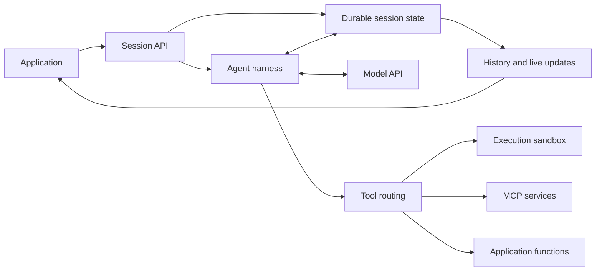

# OpenAI and Claude managed agent architecture

Documentation baseline: 13 November 2026.

Both services provide an asynchronous agent runtime with durable session state, tools, and execution environments. Their useful architectural boundary separates the application, session state, agent harness, and sandbox. A Pi alternative needs to reproduce these responsibilities and define its own public guarantees.

This comparison covers OpenAI **Agents API** and **Claude Managed Agents**. OpenAI's Agents API explicitly runs a managed Codex harness. Anthropic describes Managed Agents as a configurable managed harness; its documentation does not establish that it is simply the Claude Code CLI running remotely. [OpenAI overview](https://developers.openai.com/api/docs/guides/agents-api/overview), [Claude overview](https://platform.claude.com/docs/en/managed-agents/overview).

## Runtime boundaries

OpenAI documents three participants: the hosted harness runs the model and tool loop, an optional environment supplies compute and files, and the application submits work and handles application functions. It supports `none`, `openai_hosted`, and `self_hosted` environment modes. Even with self-hosted compute, OpenAI runs the harness. [OpenAI architecture](https://developers.openai.com/api/docs/guides/agents-api/architecture).

Anthropic's engineering description separates durable session history, the harness, and sandbox execution. The session log exists outside the harness and outside the model's context window. That enables replacement of a failed harness independently of a failed sandbox, and allows context compaction without destroying the underlying history. This is a published description of their decomposition; it does not disclose their complete hosted infrastructure. [Anthropic engineering](https://www.anthropic.com/research/managed-agents).

The following is a conceptual synthesis of those responsibilities, rather than a claim about either vendor's private service topology:

## Resources and configuration

| Concern | OpenAI Agents API | Claude Managed Agents |
| --- | --- | --- |
| Reusable behavior | A saved agent, or inline session configuration | A versioned agent resource |
| Session creation | Agent configuration or `agent_id`, environment, optional initial input subject to environment rules | Agent and environment references; optional `initial_events` |
| Configuration reuse | A session copies saved settings at creation; later saved-agent edits affect new sessions | A session can reference a particular agent version |
| Execution configuration | Inline environment settings, environment templates, or eligible existing environments | Reusable environment resource; cloud sessions get separate sandboxes |
| Continuing work | Input events on the existing session | User events on the existing session |

OpenAI permits session-specific overrides and later changes to tools, model, reasoning effort, and service tier. Model settings apply to subsequently started turns; function and MCP tool changes apply on the next model call, and built-in tool changes by the next turn. Anthropic supports creation-time overrides, but subsequent session updates are limited to tools and MCP servers; those updates require an idle session with no open workflow run. These differences argue for explicit configuration revisions in our API. [OpenAI configuration](https://developers.openai.com/api/docs/guides/agents-api/configuration), [Claude session creation](https://platform.claude.com/docs/en/managed-agents/sessions), [Claude session operations](https://platform.claude.com/docs/en/managed-agents/session-operations).

An environment configuration and a running sandbox have different lifetimes. Anthropic explicitly allows multiple sessions to reference one environment while giving each cloud session an isolated container. OpenAI says templates preserve configuration, not a running workspace. [Claude environments](https://platform.claude.com/docs/en/managed-agents/environments), [OpenAI hosted sandboxes](https://developers.openai.com/api/docs/guides/agents-api/environments/openai-hosted).

## Input and completion semantics

In OpenAI, a message to an idle session starts a turn; a message during a turn steers it. The turn ends with a completed, failed, or cancelled outcome. Session idleness alone does not establish success, and a completed turn can contain unsuccessful tools. Input retries reuse the same idempotency key for the same logical submission. [OpenAI sessions](https://developers.openai.com/api/docs/guides/agents-api/sessions).

Claude accepts user messages and interrupts as events. An idle notification can indicate an ended turn or a pause for a tool result or approval. For blocking calls, `stop_reason.type` is `requires_action`, and `stop_reason.event_ids` identifies the events needing responses. [Claude events](https://platform.claude.com/docs/en/managed-agents/events-and-streaming).

Claude also has workflow runs that can remain open while a session is idle. Its completion procedure checks that all observed runs have ended and that the session subsequently reaches `end_turn`. A budget pause or interrupt is not successful completion. [Claude workflow runs](https://platform.claude.com/docs/en/managed-agents/workflow-runs).

**Design implication:** represent session lifecycle, current activity, outstanding actions, and individual run outcomes separately. Closing a client connection must not imply cancellation.

## Streams and recovery

| Contract | OpenAI | Claude |
| --- | --- | --- |
| Live transport | Session SSE events | Session SSE events |
| Historical representation | Saved items and turns, with separate subagent history | Persisted session events and thread history |
| Reconnection | Open a new stream, buffer events, fetch session/items, merge by item identity | Open a new stream, fetch history, deduplicate live events by event ID |
| Missed intermediate output | Not all intermediate events can be recovered | Preview deltas are distinct from completed events |

Neither documented live stream automatically replays all missed output. OpenAI explicitly recovers completed state from saved items. Claude explicitly combines a new stream with event history. These are separate transport and persistence contracts. [OpenAI events and items](https://developers.openai.com/api/docs/guides/agents-api/sessions/events), [Claude events](https://platform.claude.com/docs/en/managed-agents/events-and-streaming).

**Design implication:** a resumable event feed would be our own API feature. Define its cursor, retention, deduplication, snapshot behavior, and treatment of partial output precisely.

## Tool execution and approvals

Both services support tools executed by the platform and custom tools executed by the application. In OpenAI, function calls appear in `required_actions`; the application returns a result associated with the turn and call IDs. Historical tool-call items alone do not tell the application which calls remain pending. The docs recommend storing side-effecting function results and checking ambiguous outcomes before retrying. [OpenAI functions](https://developers.openai.com/api/docs/guides/agents-api/tools/functions).

Claude's server-executed toolsets support `always_allow`, `always_ask`, and `auto` policies. The agent toolset defaults to allow; MCP toolsets default to ask. Custom tools run under the application's own control. [Claude permission policies](https://platform.claude.com/docs/en/managed-agents/permission-policies).

OpenAI's session-level `review` selects `auto_review` or `none`. Automatic review uses a reviewer model for supported approval requests and preserves environment network restrictions. Setting `none` does not redirect those actions to a generic manual-approval handler. [OpenAI automatic review](https://developers.openai.com/api/docs/guides/agents-api/sessions/approvals).

**Design implication:** approvals, custom-tool requests, and tool results are durable workflow state. A generic approval API must have its own defined behavior; vendor policy names are not interchangeable.

## Execution environments and deployment

OpenAI self-hosted execution uses `codex exec-server`. It initiates outbound connections and exchanges commands/results over WebSocket. The application API key stays outside the execution environment; the executor receives a separate restricted environment key. [OpenAI self-hosted sandboxes](https://developers.openai.com/api/docs/guides/agents-api/environments/self-hosted).

Claude's self-hosted environment acts as a work queue. A customer worker claims a session and executes requested tools. Hosting that worker does not move model inference or the hosted service's conversation history onto customer infrastructure. [Claude self-hosted sandboxes](https://platform.claude.com/docs/en/managed-agents/self-hosted-sandboxes).

Claude additionally documents **self-hosted Managed Agents**, where the customer hosts the API, agent loop, storage, and sandboxes. Its service is `cma-server`, backed by PostgreSQL for persistence, with separate execution workers. Inference still goes to a configured provider. Therefore, self-hosting alone is not a sufficient differentiator for a new Pi service; harness control and model flexibility are more meaningful product choices. [Claude self-hosted service](https://platform.claude.com/docs/en/managed-agents/self-hosted).

OpenAI's lifecycle guide makes several limits explicit: a session can outlive its compute, replacement compute does not restore files merely by reusing an environment ID, mid-turn disconnections can fail tools, and session deletion does not clean up customer compute. [OpenAI sandbox lifecycle](https://developers.openai.com/api/docs/guides/agents-api/environments/lifecycle).

**Design implication:** sandbox provisioning, connection, shutdown, workspace persistence, and cleanup require their own controller and reconciliation rules.

## Credentials and artifacts

OpenAI vault credentials can authenticate MCP connections or supply placeholders that an egress proxy substitutes with real secrets for approved destinations. Anthropic also documents MCP credentials and opaque environment placeholders resolved at egress. Credentials are referenced by sessions rather than embedded in reusable prompts. These mechanisms must be scoped to the acting user and permitted service. [OpenAI vaults](https://developers.openai.com/api/docs/guides/agents-api/tools/vaults), [Claude vaults](https://platform.claude.com/docs/en/managed-agents/vaults).

OpenAI distinguishes live workspace files from published immutable artifacts. Files under the hosted workspace's output directory become downloadable artifacts on turn completion, and published copies outlive sandbox expiry. The hosted Artifacts API does not publish self-hosted files automatically. [OpenAI files and artifacts](https://developers.openai.com/api/docs/guides/agents-api/environments/files).

**Design implication:** credentials, workspace state, uploaded inputs, and published outputs need separate authorization and retention policies.

## Orchestration and operations

OpenAI's harness can supply subagent creation, messaging, waiting, and interruption tools. Each subagent has its own context. Claude supports both subagents and dynamic workflows, with separate conversation threads and potentially shared sandbox files. Conversation isolation does not imply filesystem isolation. [OpenAI multi-agent](https://developers.openai.com/api/docs/guides/agents-api/multi-agent), [Claude multiagent orchestration](https://platform.claude.com/docs/en/managed-agents/multiagent-orchestration).

Both platforms document session inspection and usage reporting. OpenAI exposes root/subagent turn usage and traces; Claude exposes token usage, list cost, and OpenTelemetry integration. Claude's budget stops new model requests when the limit is reached, while an in-flight request can finish beyond it. [OpenAI observability](https://developers.openai.com/api/docs/guides/agents-api/observability), [Claude observability](https://platform.claude.com/docs/en/managed-agents/session-observability), [Claude budgets](https://platform.claude.com/docs/en/managed-agents/budgets).

**Design implication:** meter by session, run, thread, model request, and tool call. Cancellation scope, budget reservation, and shared-workspace behavior must be explicit before adding parallel agents.

## Requirements for the Pi alternative

The common architectural requirements are durable input acceptance, independent session and compute lifecycles, recoverable run state, externally enforced execution isolation, application tool results, permissions, secret mediation, artifacts, and observable usage.

Our public design should additionally specify single-writer ownership, ambiguous tool outcomes, resumable semantic events, and runtime version pinning. Those are proposed guarantees, not assumptions about undocumented vendor internals. The [Pi architecture proposal](architecture.md) maps these responsibilities to concrete Pi interfaces.
